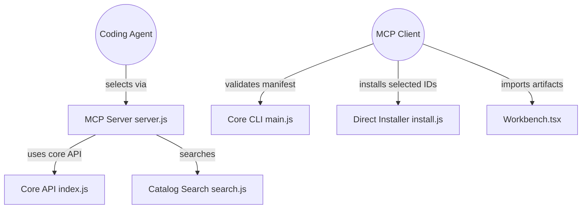

# sickn33/agentic-awesome-skills

> Bibliothèque de 2 884+ skills SKILL.md pour agents de code, avec un MCP local pour les choisir.

## Le problème
Les playbooks pour agents (Claude Code, Codex, Cursor, Gemini CLI) sont dispersés, et on ne sait pas lesquels installer sans saturer le contexte.

## Ce que ça fait vraiment
- Fournit un catalogue de skills dans `skills/`, avec `skills_index.json` lisible par machine.
- AAS Core (MCP local + CLI `aas`) cherche et lit le catalogue ; c'est l'agent qui choisit les IDs, Core ne classe ni ne recommande.
- Le CLI valide un manifeste `aas-stack.json` et écrit un aperçu immuable ; appliquer et restaurer restent expérimentaux.
- Un installateur direct copie des skills choisis dans le dossier de l'hôte, avec `--dry-run`.

## Comment c'est branché


## Essayer
```bash
npm exec --yes --ignore-scripts --package=agentic-awesome-skills@20.3.0 -- \
  agentic-awesome-skills --release 20.3.0 --path .agents/skills \
  --skills brainstorming,systematic-debugging --dry-run
```

## Coût et pièges
Gratuit, MIT. Installer tout le catalogue peut surcharger le contexte de l'agent (le README le dit pour Antigravity). Plusieurs skills « officiels » listés renvoient à des services hébergés payants.

## Ce que ce n'est pas
Pas un recommandeur : Core ne classe rien. Une validation structurelle ne certifie ni l'adéquation ni la sûreté d'un skill. Projet communautaire, non affilié à Google.

## Alternatives
- anthropics/skills : source officielle Anthropic, plus restreinte.
- openai/skills : catalogue officiel côté Codex.
- huggingface/skills : skills dédiés à l'écosystème Hugging Face.

## Pour toi
À surveiller : utile pour piocher des skills ciblés, mais à installer au cas par cas avec `--dry-run`, car le volume et l'origine variée appellent une revue avant usage.

