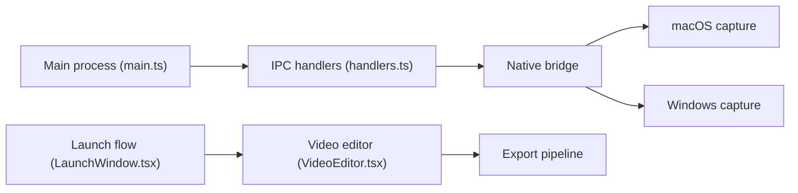

# siddharthvaddem/openscreen

> Free, open screen-recording editor for producing polished demos, a free alternative to Screen Studio.

## The problem
Screen Studio costs $29/month. Free recorders offer neither automatic zooms nor demo formatting.

## What it actually does
- Records a window or the screen, with microphone, system audio and webcam.
- Auto zooms following the cursor, click effects, motion blur, backgrounds, cropping, per-segment speed.
- Captions generated on the machine, with nothing sent out (offline).
- MP4 or GIF export. Electron application; native capture on macOS (ScreenCaptureKit) and Windows (wgc-capture), browser-based on Linux.

## How it is wired


## Trying it
```bash
brew install --cask siddharthvaddem/openscreen/openscreen
winget install SiddharthVaddem.OpenScreen
sudo apt install ./Openscreen-Linux-latest.deb
```

## Cost and gotchas
Free. On macOS, the Screen Recording and Accessibility permissions must be granted; on Linux: PipeWire for system audio, and the `--no-sandbox` option is sometimes required for the AppImage.

## What it is not
Not maintained: the README announces the archiving and points to getopenscreen/openscreen. Not a 1:1 clone of Screen Studio, and the author says it is "not production grade". On Linux, no custom cursors.

## Alternatives
getopenscreen/openscreen: maintained successor of the project, named in the README.

## For you
Ignore: archived repository and off-topic for data/AI; if you want the tool, go straight to the maintained successor.
