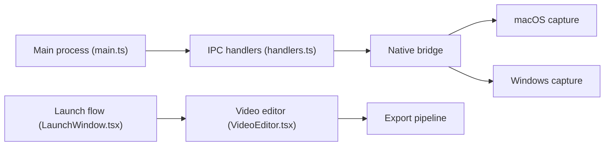

# siddharthvaddem/openscreen

> Éditeur d'enregistrement d'écran libre pour produire des démos soignées, alternative gratuite à Screen Studio.

## Le problème
Screen Studio coûte 29 $/mois. Les enregistreurs gratuits ne font ni zooms automatiques ni mise en forme de démos.

## Ce que ça fait vraiment
- Enregistre une fenêtre ou l'écran, avec micro, audio système et webcam.
- Zooms auto suivant le curseur, effets de clic, flou de mouvement, fonds, recadrage, vitesse par segment.
- Sous-titres générés sur la machine, sans envoi (hors ligne).
- Export MP4 ou GIF. Application Electron ; capture native macOS (ScreenCaptureKit) et Windows (wgc-capture), navigateur sous Linux.

## Comment c'est branché


## Essayer
```bash
brew install --cask siddharthvaddem/openscreen/openscreen
winget install SiddharthVaddem.OpenScreen
sudo apt install ./Openscreen-Linux-latest.deb
```

## Coût et pièges
Gratuit. Sur macOS, permissions Enregistrement d'écran et Accessibilité à accorder ; Linux : PipeWire pour l'audio système, option `--no-sandbox` parfois requise pour l'AppImage.

## Ce que ce n'est pas
Pas maintenu : le README annonce l'archivage et renvoie vers getopenscreen/openscreen. Pas un clone 1:1 de Screen Studio, et l'auteur le dit « pas production grade ». Sous Linux, pas de curseurs personnalisés.

## Alternatives
getopenscreen/openscreen : suite maintenue du projet, nommée dans le README.

## Pour toi
À ignorer : dépôt archivé et hors sujet data/IA ; si tu veux l'outil, passe directement par la suite maintenue.

