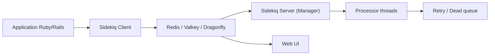

# sidekiq/sidekiq

> Multithreaded Ruby background job library backed by Redis, for Rails or Ruby applications.

## The problem
Long tasks (sending emails, network calls) block web requests if they are run inline.

## What it actually does
Threads process many jobs in parallel within a single process, with queues stored in Redis 7+, Valkey or Dragonfly. The README advertises a benchmark of 500,000 empty jobs (`bin/sidekiqload`) and a throughput measured in 7.0.3. A web interface and ActiveJob support exist. The graph is not readable; the architecture description is generic.

## How it is wired


## Trying it
```bash
bundle add sidekiq
bundle up sidekiq        # mise à jour
bin/lint-herb            # lint ERB (contributeurs)
```

## Cost and gotchas
Free, but Redis is required. Pro and Enterprise are paid (commercial license) and provide private support. No direct contact with the maintainers.

## What it is not
Not a workflow engine nor a data pipeline orchestrator. The Pro/Enterprise features are not in the free version.

## Alternatives
No alternative named in the README.

## For you
Worth watching: only if you have a Ruby backend; in Python, another task manager will be more natural. The license, not identified by GitHub, needs to be checked.
