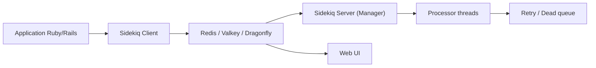

# sidekiq/sidekiq

> Bibliothèque Ruby de jobs en arrière-plan, multithread, adossée à Redis, pour applications Rails ou Ruby.

## Le problème
Les tâches longues (envois d'e-mails, appels réseau) bloquent les requêtes web si on les exécute en ligne.

## Ce que ça fait vraiment
Des threads traitent de nombreux jobs en parallèle dans un même processus, avec les files stockées dans Redis 7+, Valkey ou Dragonfly. Le README annonce un banc de 500 000 jobs vides (`bin/sidekiqload`) et un débit mesuré en 7.0.3. Une interface web et un support d'ActiveJob existent. Le graphe n'est pas lisible ; la description d'architecture est générique.

## Comment c'est branché


## Essayer
```bash
bundle add sidekiq
bundle up sidekiq        # mise à jour
bin/lint-herb            # lint ERB (contributeurs)
```

## Coût et pièges
Gratuit, mais Redis est obligatoire. Pro et Enterprise sont payants (licence commerciale) et donnent le support privé. Pas de contact direct avec les mainteneurs.

## Ce que ce n'est pas
Pas un moteur de workflows ni un orchestrateur de pipelines de données. Les fonctions Pro/Enterprise ne sont pas dans la version gratuite.

## Alternatives
Aucune alternative nommée dans le README.

## Pour toi
À surveiller : seulement si tu as un backend Ruby ; en Python, un autre gestionnaire de tâches sera plus naturel. La licence, non identifiée par GitHub, est à vérifier.

