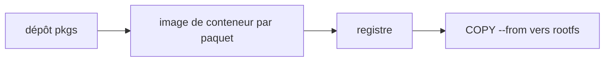

# siderolabs/pkgs

> Packages published as container images for building the rootfs of a custom Linux distribution.

## The problem
Building a root filesystem for a custom distribution requires compiling and assembling many packages.

## What it actually does
Produces a set of packages published as container images. You "install" them by copying their contents into the rootfs, with a `COPY --from` in a `FROM scratch` Dockerfile. The README says little beyond this example.

## How it is wired
Simplified diagram based on the sheet, no diagram provided.



## Trying it
```docker
FROM scratch
COPY --from=<registry>/<organization>/<pkg>:<tag> / /
```

## Cost and gotchas
Docker required. The README says nothing about the list of packages or the build process. MPL-2.0 licence, weak copyleft.

## What it is not
It is not a full distribution or a package manager: these are building blocks to assemble.

## Alternatives
No alternative named in the README.

## For you
Ignore: a low-level building block for designing an operating system, unrelated to a data, AI or MLOps profile.
