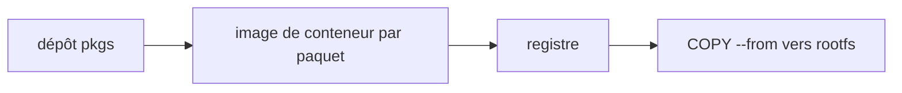

# siderolabs/pkgs

> Paquets publiés comme images de conteneur pour construire le rootfs d'une distribution Linux personnalisée.

## Le problème
Construire un système de fichiers racine pour une distribution sur mesure demande de compiler et d'assembler de nombreux paquets.

## Ce que ça fait vraiment
Produit un ensemble de paquets publiés sous forme d'images de conteneur. On les « installe » en copiant leur contenu dans le rootfs, avec un `COPY --from` dans un Dockerfile `FROM scratch`. Le README en dit peu au-delà de cet exemple.

## Comment c'est branché
Schéma simplifié d'après la fiche, sans diagramme fourni.



## Essayer
```docker
FROM scratch
COPY --from=<registry>/<organization>/<pkg>:<tag> / /
```

## Coût et pièges
Docker requis. Le README ne dit rien de la liste des paquets ni du processus de construction. Licence MPL-2.0 à copyleft faible.

## Ce que ce n'est pas
Ce n'est pas une distribution complète ni un gestionnaire de paquets : ce sont des briques à assembler.

## Alternatives
Aucune alternative nommée dans le README.

## Pour toi
À ignorer : brique bas niveau pour concevoir un système d'exploitation, sans rapport avec un profil data, IA ou MLOps.

