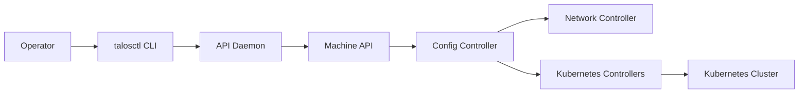

# siderolabs/talos

> Minimal, immutable Linux operating system dedicated to Kubernetes, administered only through an API.

## The problem
Kubernetes nodes on general-purpose Linux drift in configuration and expose a large attack surface (SSH, shell).

## What it actually does
An OS with no shell or interactive console: all management goes through an API secured with mTLS.
The operator uses `talosctl` to provision and manage nodes; the API daemon forwards to `machined`.
Controllers reconcile configuration, storage, network, containers and Kubernetes state.
Atomic updates, immutable infrastructure, stable versions of Kubernetes and Linux.

## How it is wired

## Trying it
No command in the README: it points to the documentation.

## Cost and gotchas
Free, MPL-2.0; commercial support by Sidero Labs. With no shell, debugging goes through the API.

## What it is not
Not a general-purpose Linux distribution: you cannot install packages by hand.
Not a multi-cloud cluster manager by itself.

## Alternatives
No alternative named in the README.

## For you
Worth watching if you operate Kubernetes clusters yourself for training or serving: it reduces node drift; irrelevant if you stay on managed offerings.
