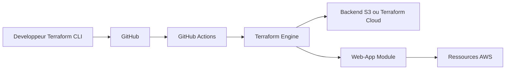

# sidpalas/devops-directive-terraform-course

> Companion repository to a Terraform video course, from beginner to CI/CD, with AWS examples.

## The problem
Learning Terraform requires a progressive path with code that runs, not just theory.

## What it actually does
Nine modules: cloud evolution, installation (EC2 hello world), basics and remote backends, variables and outputs, HCL features, modules, multiple environments (folders or workspaces), testing (bash, Terratest in Go), CI/CD workflows with GitHub Actions. The generated architecture assumes an AWS web application (compute, database, DNS, storage).

## How it is wired


## Trying it
```bash
# Aucune commande dans le README : chaque dossier 01 à 09 contient son propre code.
```

## Cost and gotchas
The AWS resources created are billed to you; an AWS account is required. Last push in June 2024, provider versions possibly outdated.

## What it is not
Not a reusable library: it is course material. No license declared, so reuse of the code is not permitted as is.

## Alternatives
No alternative named in the README.

## For you
Worth watching: good material for building IaC skills in MLOps, to be taken as an example and not as a reusable base.
