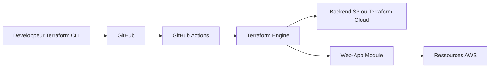

# sidpalas/devops-directive-terraform-course

> Dépôt compagnon d'un cours vidéo Terraform, du débutant à la CI/CD, avec exemples AWS.

## Le problème
Apprendre Terraform demande un parcours progressif avec du code qui tourne, pas seulement de la théorie.

## Ce que ça fait vraiment
Neuf modules : évolution du cloud, installation (EC2 hello world), bases et backends distants, variables et sorties, fonctionnalités HCL, modules, environnements multiples (dossiers ou workspaces), tests (bash, Terratest en Go), workflows CI/CD avec GitHub Actions. L'architecture générée suppose une application web AWS (compute, base, DNS, stockage).

## Comment c'est branché


## Essayer
```bash
# Aucune commande dans le README : chaque dossier 01 à 09 contient son propre code.
```

## Coût et pièges
Les ressources AWS créées sont facturées à ta charge ; un compte AWS est nécessaire. Dernier push en juin 2024, versions de providers possiblement datées.

## Ce que ce n'est pas
Pas une bibliothèque réutilisable : c'est un support de cours. Aucune licence déclarée, donc réutilisation du code non autorisée en l'état.

## Alternatives
Aucune alternative nommée dans le README.

## Pour toi
À surveiller : bon support pour monter en compétence IaC en MLOps, à prendre comme exemple et non comme base réutilisable.

