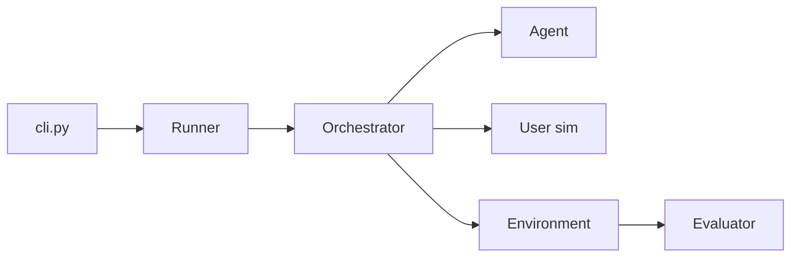

# sierra-research/tau2-bench

> Benchmark simulating a user and tools to evaluate customer-service agents.

## The problem
Evaluating a tool-using agent requires realistic scenarios, a policy to follow and a simulated user, all of which are hard to reproduce.

## What it actually does
Each domain (airline, retail, telecom, banking_knowledge, mock) provides a policy, tools and tasks. An orchestrator makes the agent, the environment and the user simulator talk to each other; an evaluator scores the actions and communications, then metrics aggregate the results. The banking_knowledge domain adds a RAG pipeline; the full-duplex voice mode goes through real-time APIs (OpenAI, Gemini, xAI). A leaderboard is published at taubench.com.

## How it is wired


## Trying it
```bash
git clone https://github.com/sierra-research/tau2-bench
cd tau2-bench
uv sync
cp .env.example .env
tau2 run --domain airline --agent-llm gpt-4.1 --user-llm gpt-4.1 \
  --num-trials 1 --num-tasks 5
```

## Cost and gotchas
API keys at your expense for both the agent and the simulated user: cost grows with tasks and trials. Installation via `uv`, Python 3.12+. Version 1.0.1 changed some scores on banking_knowledge.

## What it is not
Not a training framework (a gym interface exists as an option). It only measures customer service in the provided domains.

## Alternatives
- No alternative named in the README.

## For you
Adopt it if you evaluate tool-using agents: a reproducible framework, but measure the cost first on a small trial.
