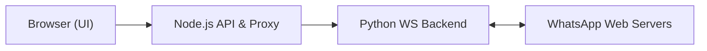

# sigalor/whatsapp-web-reveng

> Reverse-engineering documentation of the (old) WhatsApp Web protocol and a reference implementation in Python/Node.

## The problem
The WhatsApp Web WebSocket protocol is not publicly documented.

## What it actually does
Describes the connection, QR code generation, the key exchange (Curve25519, HKDF, AES-CBC, HMAC), the binary message format and encrypted media. The code combines a browser client, a Node proxy (ports 2018/2020) and a Python 2.7 backend (port 2019) that talks to the WhatsApp servers. The README also lists reimplementations in other languages.

## How it is wired


## Trying it
```bash
npm install -f
pip install -r requirements.txt
npm start
docker build . -t whatsapp-web-reveng
```

## Cost and gotchas
Free, but Python 2.7 (end of life) and Node 8+; the README says the Docker version is not stable. The protocol described is old; risk of account blocking, project not affiliated with WhatsApp.

## What it is not
Not a working current client: sending messages and session resumption are not implemented. The last push dates from April 2024.

## Alternatives
- Baileys (adiwajshing), whatsapp-web.js not cited; the README also names go-whatsapp, kyros, whatsappweb-rs.

## For you
Ignore: obsolete protocol, Python 2 stack; useful only as historical reading.
