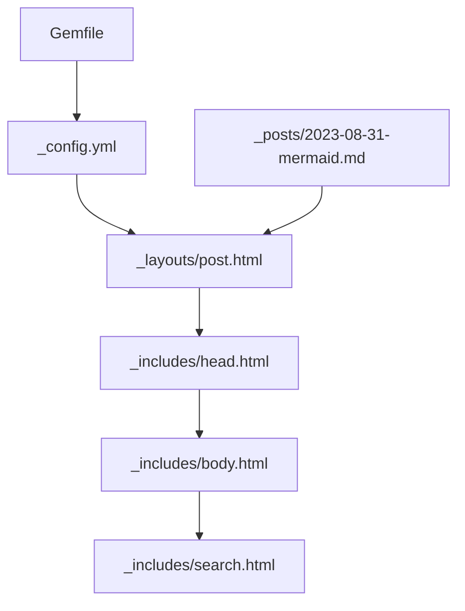

# sighingnow/jekyll-gitbook

> Jekyll theme with a GitBook look, for publishing documentation on GitHub Pages without generated HTML.

## The problem
Deploying a GitBook to GitHub Pages requires generating the HTML locally and then pushing it, which pollutes version control.

## What it actually does
Reproduces the GitBook style as Jekyll templates: `_config.yml` drives the collections, `home.html` and `post.html` assemble the fragments in `_includes` (head, body, toc, search). Full-text search, syntax highlighting, table of contents, Disqus comments, and optional Mermaid and MathJax.

## How it is wired


## Trying it
```bash
# Dans _config.yml, utilisation en thème distant :
# remote_theme: sighingnow/jekyll-gitbook
```
Another route: fork the repository and add your articles in `_posts`.

## Cost and gotchas
Free. Ruby and Jekyll for a local test. The theme offers Google Analytics, CNZZ, Application Insights: third-party tracking if you enable it. Last push in August 2024.

## What it is not
It is not GitBook itself nor a book generator: only a Jekyll theme.

## Alternatives
No alternative named in the README.

## For you
Ignore: a documentation theme unrelated to data / AI, barely active for over a year.
