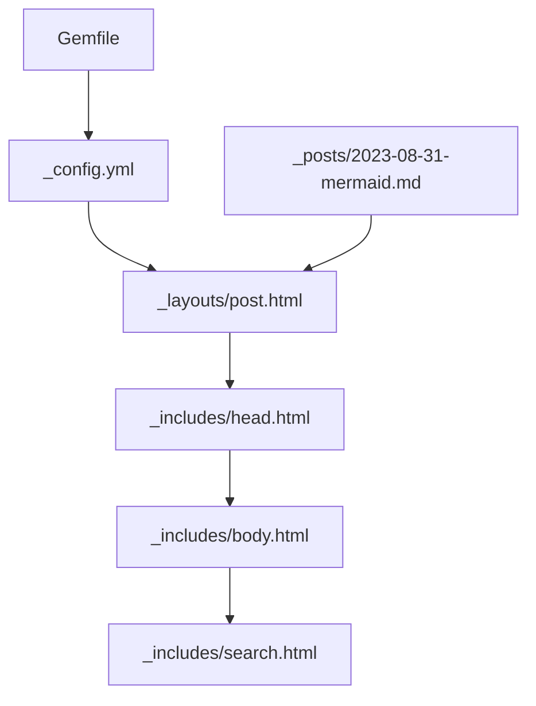

# sighingnow/jekyll-gitbook

> Thème Jekyll à l'apparence GitBook, pour publier de la documentation sur GitHub Pages sans HTML généré.

## Le problème
Déployer un GitBook sur GitHub Pages oblige à générer le HTML en local puis à le pousser, ce qui pollue le versionnement.

## Ce que ça fait vraiment
Reprend le style GitBook sous forme de gabarits Jekyll : `_config.yml` pilote les collections, `home.html` et `post.html` assemblent les fragments de `_includes` (head, body, toc, search). Recherche plein texte, coloration, table des matières, commentaires Disqus, Mermaid et MathJax en option.

## Comment c'est branché


## Essayer
```bash
# Dans _config.yml, utilisation en thème distant :
# remote_theme: sighingnow/jekyll-gitbook
```
Autre voie : forker le dépôt et ajouter ses articles dans `_posts`.

## Coût et pièges
Gratuit. Ruby et Jekyll pour un test local. Le thème propose Google Analytics, CNZZ, Application Insights : du suivi tiers si tu l'actives. Dernier push en août 2024.

## Ce que ce n'est pas
Ce n'est pas GitBook lui-même ni un générateur de livres : seulement un thème Jekyll.

## Alternatives
Aucune alternative nommée dans le README.

## Pour toi
À ignorer : un thème de documentation sans rapport avec data / IA, peu actif depuis plus d'un an.

