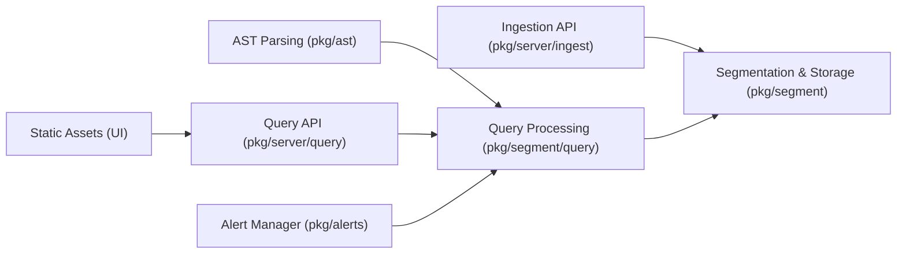

# siglens/siglens

> Single-binary Go observability database for logs, metrics and traces, now archived.

## The problem
Observability tools are expensive (Splunk, Datadog) or heavy to operate (Elasticsearch), and the data is scattered across logs, metrics and traces.

## What it actually does
A single binary ingests OpenTelemetry, Elastic, Splunk HEC and Loki, stores data in segments and answers queries in Splunk SPL or SQL. Alerts, dashboards, tracing and live tail. The speed and throughput figures (8 TB/day, 1025 x Elasticsearch) come from the project's blog posts and were not verified here.

## How it is wired

## Trying it
The README contains no commands: the installation links (Git, Docker, Helm) were removed from the supplied text. No documented command.

## Cost and gotchas
Free; Apache-2.0 license after the announced change. Repository read-only since 2026-03, 104 open issues with no follow-up.

## What it is not
Not a living project: the team is "focusing on something else". The performance comparisons are marketing arguments.

## Alternatives
- Splunk, Datadog, NewRelic: cited as expensive.
- Elasticsearch, Grafana Loki, ClickHouse: compared by the project.

## For you
Ignore: archived, so no security fixes; at best usable as a code reference or a fork.
