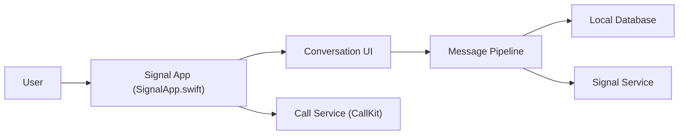

# signalapp/Signal-iOS

> Source code of the Signal encrypted messaging application for iPhone.

## The problem
Exchanging private messages without entrusting their content to a service that reads them.

## What it actually does
The README is very short: free software for private communication, iOS version. Based on the architecture described by the code: app lifecycle, registration, local database, message pipeline, calls (CallKit), media sharing, backups, device transfer, notifications. Several core modules were not sampled.

## How it is wired

## Trying it
No command documented in the README.

## Cost and gotchas
Free; relies on the Signal service. iOS build not documented here. The README contains a warning about the export of encryption software.

## What it is not
Not a reusable library, and not a client for a third-party server. AGPL-3.0 license.

## Alternatives
No alternative named in the README.

## For you
Ignore for data/AI watch: it is a messaging application, and the AGPL-3.0 forbids reusing it in proprietary code.
