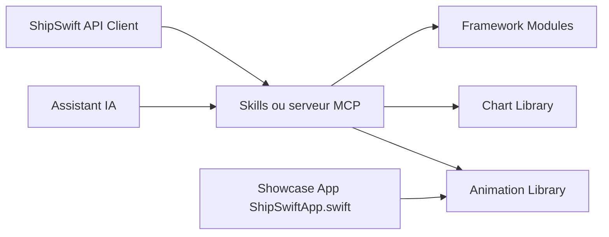

# signerlabs/ShipSwift

> Library of SwiftUI components and recipes that AI assistants fetch to build iOS apps.

## The problem
A coding assistant produces generic or outdated SwiftUI and reinvents animations, charts and authentication modules.

## What it actually does
Provides SwiftUI components (Metal animations, charts, UI, Auth, Camera, StoreKit 2 Paywall, Chat modules, etc.) and "recipes". An MCP server (`listRecipes`, `getRecipe`, `searchRecipes`) or local skills expose them to Claude Code or Gemini CLI. Pro recipes (backend, compliance, pitfalls) are paid. Showcase app included.

## How it is wired


## Trying it
```bash
npx skills add signerlabs/shipswift-skills
claude mcp add --transport http shipswift https://api.shipswift.app/mcp
npx skills add signerlabs/ShipSwift
```

## Cost and gotchas
The iOS client code is MIT; the Pro recipes and the custom development service (from $5,000) are paid. Access to Pro recipes goes through a remote server.

## What it is not
Not cross-platform nor relevant outside iOS. Part of the value sits behind a paywall and a hosted service.

## Alternatives
No alternative named in the README.

## For you
Ignore: pure iOS development, unrelated to data/AI/MLOps.
