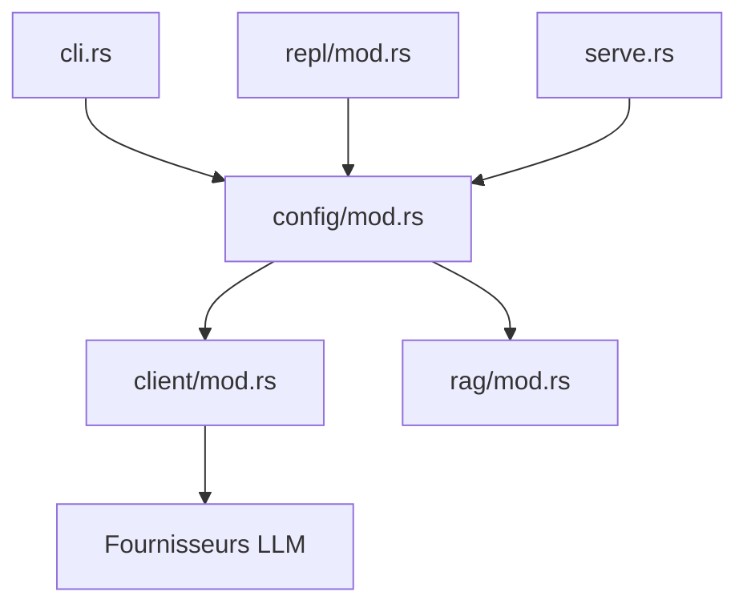

# sigoden/aichat

> Command-line tool in Rust to chat with more than twenty LLM providers.

## The problem
Each LLM provider has its own API and client; switching from one to another from the terminal is a pain.

## What it actually does
Single interface in command or REPL mode, a shell assistant that turns a request into a command, file, folder, URL and stdin inputs, roles, sessions, macros, RAG, function calling and agents. A local HTTP server exposes chat, embeddings and rerank compatible APIs, plus a playground and a comparison arena.

## How it is wired


## Trying it
```bash
cargo install aichat
brew install aichat
aichat hello
cat data.txt | aichat
aichat -f dir/ -f data.txt explain
aichat --serve
```

## Cost and gotchas
Free, but you need the API keys of each provider (or a local model via Ollama); the bill depends on them.

## What it is not
Not a model nor a fully autonomous agent. Tools and agents require the separate llm-functions repository.

## Alternatives
llm-functions by the same author, for function calling (cited in the README).

## For you
Worth adopting: a single terminal client to test several models, plug in local RAG and expose an OpenAI-compatible proxy, with packages for all systems.
