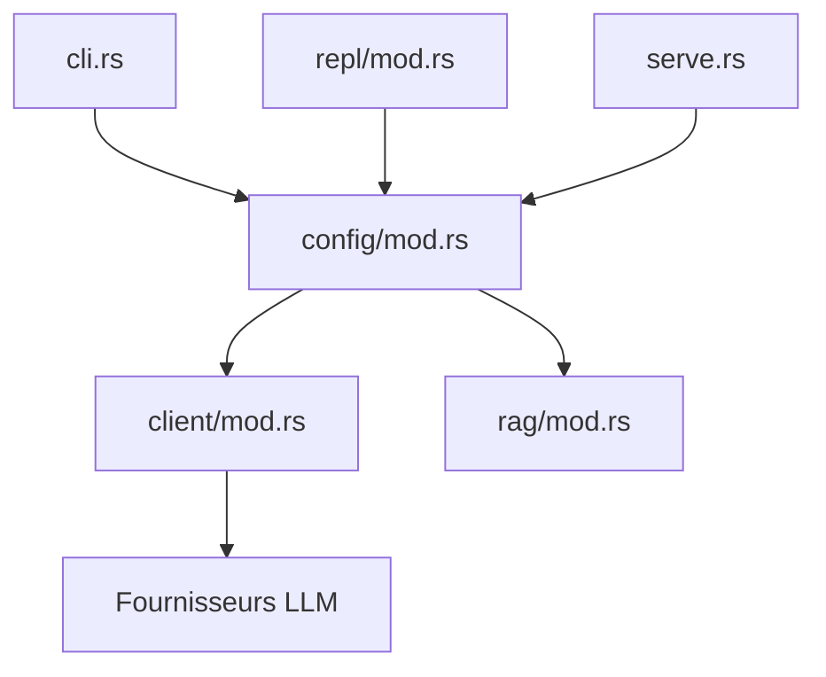

# sigoden/aichat

> Outil en ligne de commande en Rust pour discuter avec plus de vingt fournisseurs de LLM.

## Le problème
Chaque fournisseur de LLM a son API et son client ; passer de l'un à l'autre depuis le terminal est pénible.

## Ce que ça fait vraiment
Interface unique en mode commande ou REPL, assistant shell qui traduit une demande en commande, entrées fichiers, dossiers, URL et stdin, rôles, sessions, macros, RAG, appels de fonctions et agents. Un serveur HTTP local expose des API compatibles chat, embeddings et rerank, plus un playground et une arène de comparaison.

## Comment c'est branché


## Essayer
```bash
cargo install aichat
brew install aichat
aichat hello
cat data.txt | aichat
aichat -f dir/ -f data.txt explain
aichat --serve
```

## Coût et pièges
Gratuit, mais il faut les clés d'API de chaque fournisseur (ou un modèle local via Ollama) ; la facture dépend d'eux.

## Ce que ce n'est pas
Pas un modèle ni un agent autonome complet. Les outils et agents demandent le dépôt séparé llm-functions.

## Alternatives
llm-functions du même auteur, pour l'appel de fonctions (cité dans le README).

## Pour toi
À adopter : un seul client terminal pour tester plusieurs modèles, brancher du RAG local et exposer un proxy compatible OpenAI, avec des paquets pour tous les systèmes.

