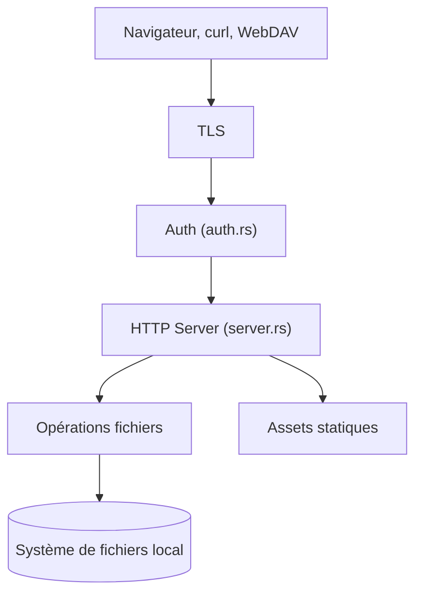

# sigoden/dufs

> Lightweight file server in Rust: static files, upload, search, access control and WebDAV.

## The problem
Sharing or retrieving files between machines without setting up a full server.

## What it actually does
Serves a folder over HTTP or HTTPS with drag-and-drop, zip archive, search, resumable transfers, WebDAV and basic or digest authentication per path. Everything is disabled by default (read-only) and enabled through options; configuration via CLI, `DUFS_*` variables or a YAML file. Customizable interface.

## How it is wired


## Trying it
```bash
cargo install dufs
docker run -v `pwd`:/data -p 5000:5000 --rm sigoden/dufs /data -A
dufs -A
dufs -a admin:123@/:rw
dufs --tls-cert my.crt --tls-key my.key
```

## Cost and gotchas
Free, Apache-2.0. `-A` allows everything, including deletion and upload: restrict it. Digest does not work with hashed passwords.

## What it is not
Not cloud storage nor an advanced multi-user server: accounts are defined on the command line or in a file.

## Alternatives
None named in the README (third-party interfaces are listed).

## For you
Adopt: handy for exchanging datasets or artifacts on a local network; never expose it with `-A` without authentication.
