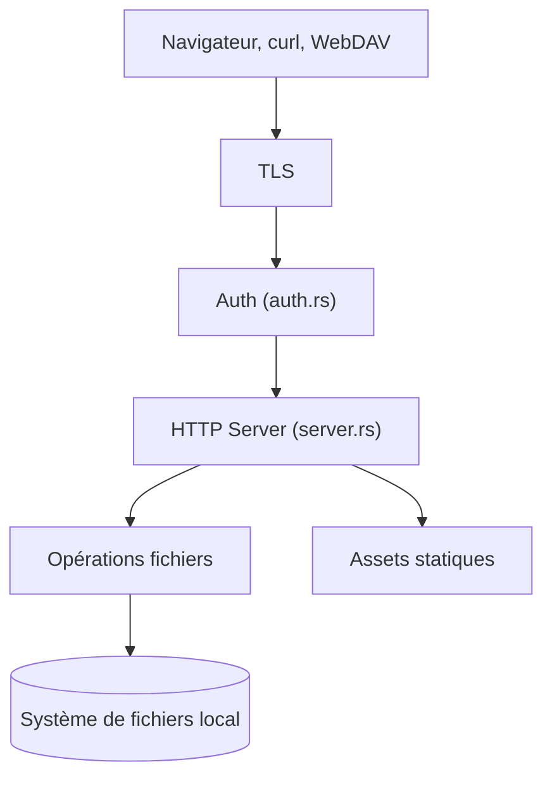

# sigoden/dufs

> Serveur de fichiers léger en Rust : statique, téléversement, recherche, contrôle d'accès et WebDAV.

## Le problème
Partager ou récupérer des fichiers entre machines sans monter un serveur complet.

## Ce que ça fait vraiment
Sert un dossier en HTTP ou HTTPS avec glisser-déposer, archive zip, recherche, reprise de transferts, WebDAV et authentification basic ou digest par chemin. Tout est désactivé par défaut (lecture seule) et s'active par options ; configuration par CLI, variables `DUFS_*` ou fichier YAML. Interface personnalisable.

## Comment c'est branché


## Essayer
```bash
cargo install dufs
docker run -v `pwd`:/data -p 5000:5000 --rm sigoden/dufs /data -A
dufs -A
dufs -a admin:123@/:rw
dufs --tls-cert my.crt --tls-key my.key
```

## Coût et pièges
Gratuit, Apache-2.0. `-A` autorise tout, y compris suppression et téléversement : à restreindre. Digest ne marche pas avec les mots de passe hachés.

## Ce que ce n'est pas
Pas un stockage cloud ni un serveur multi-utilisateurs avancé : comptes définis en ligne de commande ou fichier.

## Alternatives
Aucune nommée dans le README (des interfaces tierces sont listées).

## Pour toi
Adopter : pratique pour échanger datasets ou artefacts sur un réseau local ; ne jamais l'exposer avec `-A` sans authentification.

