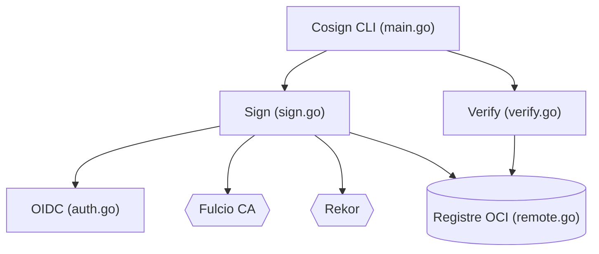

# sigstore/cosign

> Command-line tool to sign and verify container images and other artifacts via Sigstore.

## The problem
There is no way to prove that a downloaded image or binary really comes from its author and has not been modified.

## What it actually does
Cosign signs an artifact stored in an OCI registry, by default in "keyless" mode: OIDC authentication, an ephemeral certificate from the Fulcio authority, a trace in the Rekor transparency log. It also handles local keys, hardware, KMS, in-toto attestations and blob signing. The signature is stored in the registry next to the image; verification checks identity and issuer.

## How it is wired


## Trying it
```bash
cosign sign $IMAGE
cosign verify $IMAGE --certificate-identity=$IDENTITY --certificate-oidc-issuer=$OIDC_ISSUER
cosign sign-blob artifact --bundle artifact.sigstore.json --yes
```

## Cost and gotchas
Free. Keyless mode publishes your identity (e-mail) in public logs, permanently; it depends on Sigstore services, so an outage makes signing fail. Always sign by digest, not by tag.

## What it is not
Not a vulnerability scanner or a registry. The README itself lists limits: ECDSA-P256 only, signatures not deleted along with the image.

## Alternatives
- Notary v2: the README points to a comparison.
- containers/image signing: similar, but signs with PGP.
- TUF: considered complementary.

## For you
Adopt for signing your model and pipeline images: it is the standard building block of the software supply chain and it remains active.
