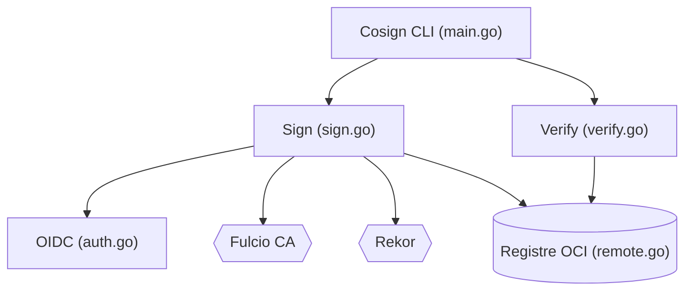

# sigstore/cosign

> Outil en ligne de commande pour signer et vérifier des images de conteneurs et autres artefacts via Sigstore.

## Le problème
Impossible de prouver qu'une image ou un binaire téléchargé vient bien de son auteur et n'a pas été modifié.

## Ce que ça fait vraiment
Cosign signe un artefact stocké dans un registre OCI, par défaut en mode « keyless » : authentification OIDC, certificat éphémère de l'autorité Fulcio, trace dans le journal de transparence Rekor. Il gère aussi des clés locales, du matériel, des KMS, des attestations in-toto et la signature de blobs. La signature est stockée dans le registre à côté de l'image ; la vérification contrôle identité et émetteur.

## Comment c'est branché


## Essayer
```bash
cosign sign $IMAGE
cosign verify $IMAGE --certificate-identity=$IDENTITY --certificate-oidc-issuer=$OIDC_ISSUER
cosign sign-blob artifact --bundle artifact.sigstore.json --yes
```

## Coût et pièges
Gratuit. Le mode keyless publie ton identité (e-mail) dans des journaux publics, de façon permanente ; il dépend des services Sigstore, une panne fait échouer la signature. Signe toujours par digest, pas par tag.

## Ce que ce n'est pas
Pas un scanneur de vulnérabilités ni un registre. Le README liste lui-même des limites : ECDSA-P256 uniquement, signatures non supprimées avec l'image.

## Alternatives
- Notary v2 : le README renvoie à un comparatif.
- containers/image signing : proche, mais signe en PGP.
- TUF : jugé complémentaire.

## Pour toi
À adopter pour signer les images de modèles et de pipelines : c'est la brique standard de la chaîne d'approvisionnement logicielle et elle reste active.

