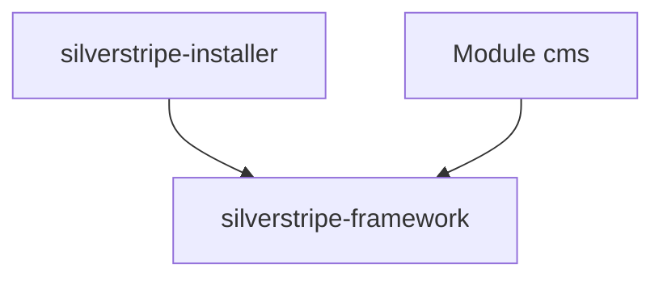

# silverstripe/silverstripe-framework

> PHP framework underlying the Silverstripe CMS, to be used with an installer project.

## The problem
Building a CMS in PHP requires a common layer of models, data access and templates.

## What it actually does
The README is very short: it presents the framework as the foundation of the Silverstripe CMS, requires a base `silverstripe-installer` project and is usually combined with the `cms` module. The rest is not documented here (pointers to the documentation, the bug tracker and the contribution guide).

## How it is wired

Simplified diagram based on the sheet, no diagram provided.

## Trying it
```bash
# Aucune commande documentée dans le README ; voir le guide « getting started ».
```

## Cost and gotchas
Free, BSD-3-Clause license. Requires PHP and an installer project. Many open issues (706).

## What it is not
Not a full CMS on its own: you need the installer and, usually, the cms module.

## Alternatives
No alternative named in the README.

## For you
PHP CMS framework with no link to data / AI: ignore.
