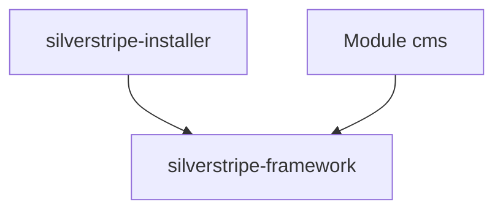

# silverstripe/silverstripe-framework

> Framework PHP à la base du CMS Silverstripe, à utiliser avec un projet installeur.

## Le problème
Construire un CMS en PHP demande une couche commune de modèles, d'accès aux données et de gabarits.

## Ce que ça fait vraiment
Le README est très court : il présente le framework comme socle du CMS Silverstripe, exige un projet `silverstripe-installer` de base et se combine en général avec le module `cms`. Le reste est non documenté ici (renvois vers la documentation, le suivi des bugs, le guide de contribution).

## Comment c'est branché

Schéma simplifié d'après la fiche, sans diagramme fourni.

## Essayer
```bash
# Aucune commande documentée dans le README ; voir le guide « getting started ».
```

## Coût et pièges
Gratuit, licence BSD-3-Clause. Nécessite PHP et un projet installeur. Beaucoup d'issues ouvertes (706).

## Ce que ce n'est pas
Pas un CMS complet à lui seul : il faut l'installeur et en général le module cms.

## Alternatives
Aucune alternative nommée dans le README.

## Pour toi
Framework PHP de CMS sans lien avec la data / IA : à ignorer.

