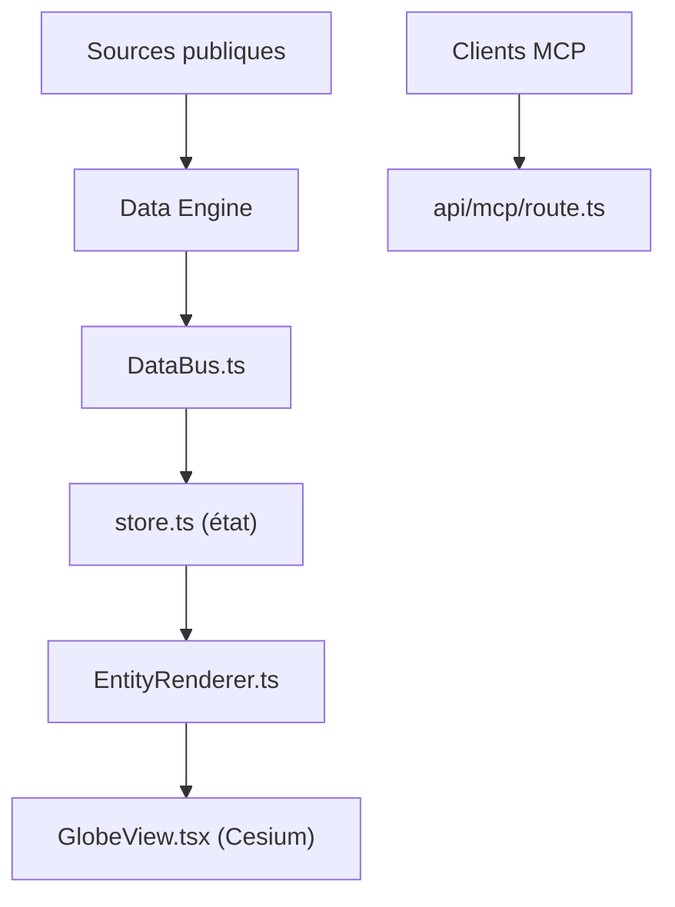

# silvertakana/worldwideview

> Real-time 3D globe with plugins for visualizing aircraft, ships and events, drivable by an MCP agent.

## The problem
Following several live geospatial feeds means stacking separate tools, with no common view.

## What it actually does
A Next.js front end displays a CesiumJS globe. Plugins connect data sources, and a bus (DataBus) relays updates over WebSocket to a Zustand state and then to rendering. An MCP endpoint `/api/mcp` lets an LLM client drive the globe, with an API key.

## How it is wired


## Trying it
```bash
mkdir worldwideview && cd worldwideview
curl -fsSL https://raw.githubusercontent.com/silvertakana/worldwideview/main/self-host/setup.sh | bash
git clone https://github.com/silvertakana/worldwideview.git
cd worldwideview
pnpm install
pnpm run setup
pnpm run dev:all
```

## Cost and gotchas
Free, but it needs Node 20+, pnpm, Docker and PostgreSQL; the photorealistic tiles come from Google. A license is present but not identified. The `curl | bash` script should be reviewed before running.

## What it is not
Not a data platform: the collection engine lives in another repository (wwv-data-engine). The README mentions protected content used under fair use.

## Alternatives
No alternative named in the README.

## For you
Worth watching: the MCP endpoint and the plugin architecture are interesting for feed visualization, but the repository is recent (March 2026) and the license remains to be clarified.
