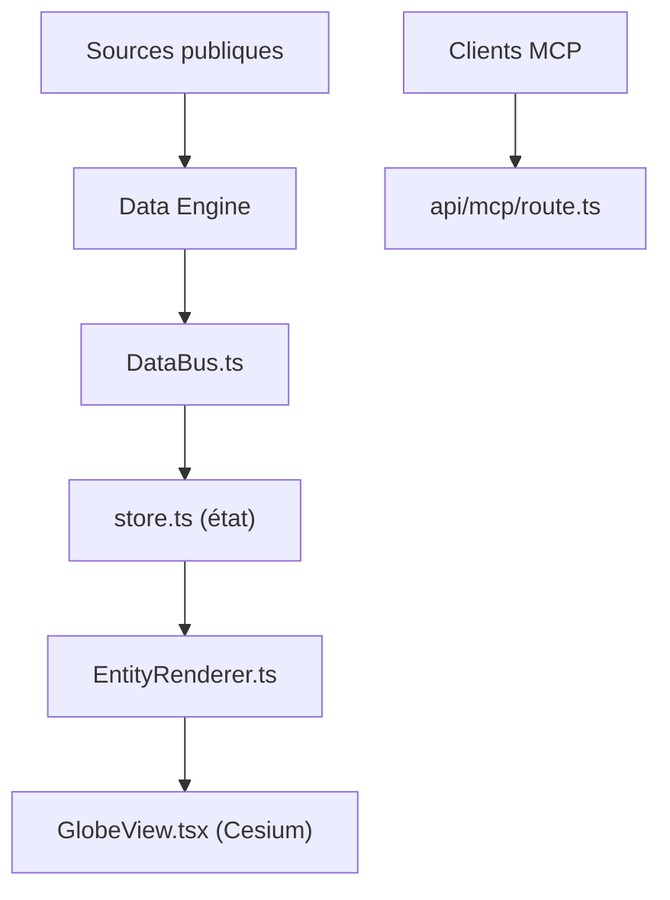

# silvertakana/worldwideview

> Globe 3D temps réel à plugins pour visualiser avions, navires et événements, pilotable par un agent MCP.

## Le problème
Suivre plusieurs flux géospatiaux en direct oblige à empiler des outils séparés, sans vue commune.

## Ce que ça fait vraiment
Un front Next.js affiche un globe CesiumJS. Des plugins branchent des sources de données, un bus (DataBus) relaie les mises à jour par WebSocket vers un état Zustand puis le rendu. Un endpoint MCP `/api/mcp` permet à un client LLM de piloter le globe, avec clé d'API.

## Comment c'est branché


## Essayer
```bash
mkdir worldwideview && cd worldwideview
curl -fsSL https://raw.githubusercontent.com/silvertakana/worldwideview/main/self-host/setup.sh | bash
git clone https://github.com/silvertakana/worldwideview.git
cd worldwideview
pnpm install
pnpm run setup
pnpm run dev:all
```

## Coût et pièges
Gratuit, mais il faut Node 20+, pnpm, Docker et PostgreSQL ; les tuiles photoréalistes viennent de Google. Licence présente mais non identifiée. Le script `curl | bash` est à relire avant exécution.

## Ce que ce n'est pas
Pas une plateforme de données : le moteur de collecte est dans un autre dépôt (wwv-data-engine). Le README évoque du contenu protégé utilisé au titre du fair use.

## Alternatives
Aucune alternative nommée dans le README.

## Pour toi
À surveiller : l'endpoint MCP et l'architecture à plugins sont intéressants pour la visualisation de flux, mais le dépôt est récent (mars 2026) et la licence reste à clarifier.

