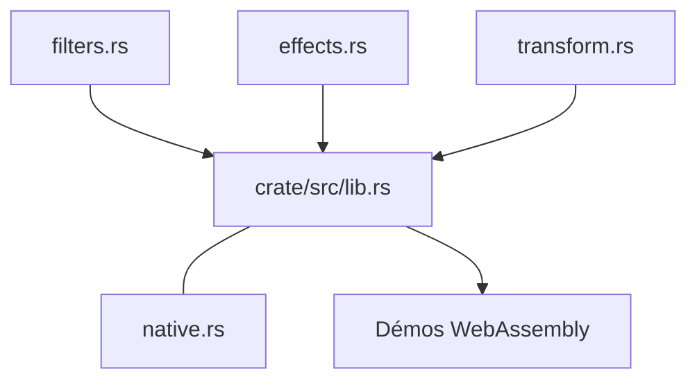

# silvia-odwyer/photon

> A Rust image-processing library, compilable to WebAssembly, for browsers, Node and native apps.

## The problem
Applying filters, resizing or recoloring images in the browser or on a server often requires heavy dependencies.

## What it actually does
96 functions to correct, filter, crop, rotate, blur, watermark and blend images, across various color spaces. The same Rust code serves natively, in WebAssembly (npm) and in Node or Cloudflare Workers. The README says OpenClaw and the Pi agent use it for their images.

## How it is wired


## Trying it
```bash
npm install @silvia-odwyer/photon
npm install @silvia-odwyer/photon-node
wasm-pack build ./crate
git clone https://github.com/silvia-odwyer/photon
cargo run --release
```

## Cost and gotchas
Free, Apache-2.0. For native use you need Rust (Cargo); to build the WebAssembly, `wasm-pack`. Some effects are in the repository but not yet published on npm or crates.io.

## What it is not
Not a computer vision library: no detection or models, only pixel operations. The near-native speed claim relies on the author's own benchmarks.

## Alternatives
- Rust `image` crate: photon presents itself there as a high-level layer on top.

## For you
Keep an eye on it: useful for preprocessing images in a JavaScript or WASM pipeline, but for ML in Python other tools remain more natural.
