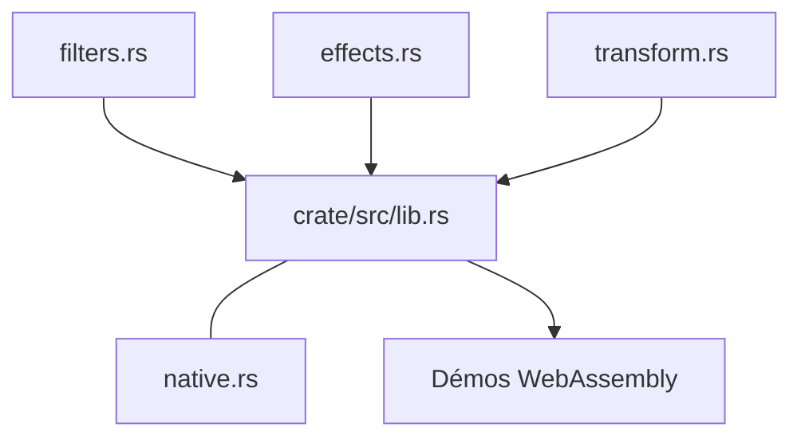

# silvia-odwyer/photon

> Bibliothèque Rust de traitement d'image, compilable en WebAssembly, pour navigateur, Node et applis natives.

## Le problème
Appliquer des filtres, redimensionner ou recolorer des images côté navigateur ou serveur demande souvent des dépendances lourdes.

## Ce que ça fait vraiment
96 fonctions pour corriger, filtrer, recadrer, pivoter, flouter, filigraner et fusionner des images, dans divers espaces colorimétriques. Le même code Rust sert en natif, en WebAssembly (npm) et dans Node ou Cloudflare Workers. Le README dit qu'OpenClaw et l'agent Pi l'utilisent pour leurs images.

## Comment c'est branché


## Essayer
```bash
npm install @silvia-odwyer/photon
npm install @silvia-odwyer/photon-node
wasm-pack build ./crate
git clone https://github.com/silvia-odwyer/photon
cargo run --release
```

## Coût et pièges
Gratuit, Apache-2.0. Pour le natif il faut Rust (Cargo) ; pour compiler le WebAssembly, `wasm-pack`. Certains effets sont dans le dépôt mais pas encore publiés sur npm ou crates.io.

## Ce que ce n'est pas
Pas une bibliothèque de vision par ordinateur : aucune détection ni modèle, seulement des opérations de pixels. L'affirmation de vitesse proche du natif renvoie à des benchmarks de l'auteur.

## Alternatives
- Rust `image` crate : photon s'y présente comme une surcouche de haut niveau.

## Pour toi
À surveiller : utile pour prétraiter des images dans un pipeline JavaScript ou WASM, mais pour du ML en Python d'autres outils restent plus naturels.

