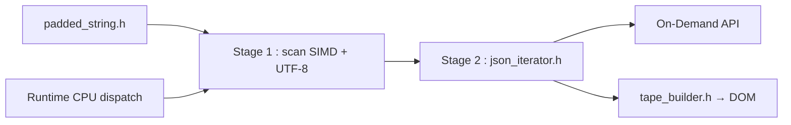

# simdjson/simdjson

> C++ library that parses JSON at several GB/s thanks to SIMD instructions.

## The problem
JSON parsing takes up a significant share of CPU time on servers and data pipelines.

## What it actually does
Two-stage parser (structural SIMD scan with UTF-8 validation, then grammar parsing), with runtime backend selection (x86, ARM64, PowerPC, LoongArch, RISC-V, scalar fallback). Two APIs: On-Demand (lazy, the default) and DOM. Serialization with a builder, including via C++26 reflection. Claims 4× RapidJSON; many Python, Rust, Node.js, Go bindings linked.

## How it is wired


## Trying it
```bash
wget https://raw.githubusercontent.com/simdjson/simdjson/master/singleheader/simdjson.h https://raw.githubusercontent.com/simdjson/simdjson/master/singleheader/simdjson.cpp https://raw.githubusercontent.com/simdjson/simdjson/master/jsonexamples/twitter.json
c++ -o quickstart quickstart.cpp simdjson.cpp
./quickstart
```

## Cost and gotchas
Free. g++ 7+ or clang++ 6+ compiler, 64-bit system. Inputs must be "padded" (`padded_string`). For a product, start from a release.

## What it is not
Not a JSON transformation tool: a parser. Some links (ports) are of varying quality, outside the repository.

## Alternatives
- RapidJSON: cited as a comparison (4× slower).
- Glaze, Serde: compared for serialization in C++26/Rust.

## For you
Adopt if you have JSON or NDJSON parsing bottlenecks in C++; via `pysimdjson` on the Python side.
