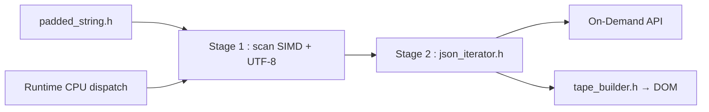

# simdjson/simdjson

> Bibliothèque C++ qui analyse le JSON à plusieurs Go/s grâce aux instructions SIMD.

## Le problème
L'analyse de JSON occupe une part importante du temps CPU des serveurs et pipelines de données.

## Ce que ça fait vraiment
Parseur en deux étapes (scan SIMD structurel avec validation UTF-8, puis analyse de la grammaire), avec sélection du backend à l'exécution (x86, ARM64, PowerPC, LoongArch, RISC-V, repli scalaire). Deux API : On-Demand (lazy, par défaut) et DOM. Sérialisation avec builder, y compris via la réflexion C++26. Revendique 4× RapidJSON ; de nombreux liens Python, Rust, Node.js, Go.

## Comment c'est branché


## Essayer
```bash
wget https://raw.githubusercontent.com/simdjson/simdjson/master/singleheader/simdjson.h https://raw.githubusercontent.com/simdjson/simdjson/master/singleheader/simdjson.cpp https://raw.githubusercontent.com/simdjson/simdjson/master/jsonexamples/twitter.json
c++ -o quickstart quickstart.cpp simdjson.cpp
./quickstart
```

## Coût et pièges
Gratuit. Compilateur g++ 7+ ou clang++ 6+, système 64 bits. Les entrées doivent être « paddées » (`padded_string`). Pour un produit, partir d'une release.

## Ce que ce n'est pas
Pas un outil de transformation de JSON : un parseur. Certains liens (ports) sont de qualité variable, hors du dépôt.

## Alternatives
- RapidJSON : cité comme comparatif (4× plus lent).
- Glaze, Serde : comparés pour la sérialisation en C++26/Rust.

## Pour toi
À adopter si tu as des goulets d'étranglement de parsing JSON ou NDJSON en C++ ; via `pysimdjson` côté Python.

