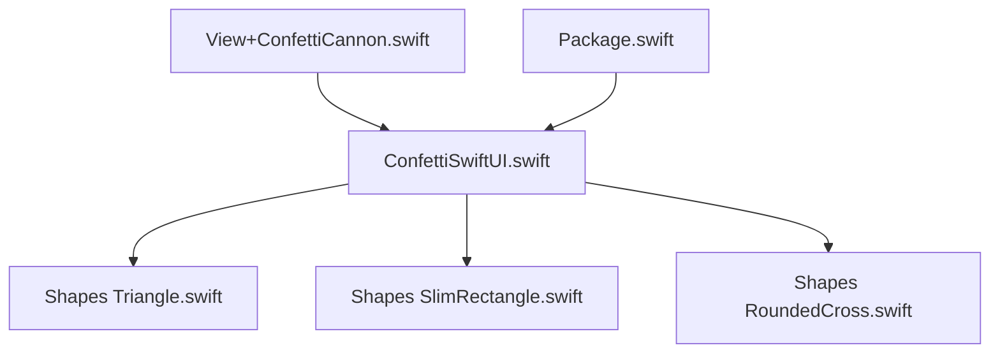

# simibac/ConfettiSwiftUI

> SwiftUI library that adds customizable confetti animations to an iOS or macOS app.

## The problem
Writing a confetti animation by hand in SwiftUI takes time.

## What it actually does
A confettiCannon modifier fires when an integer variable changes. Default shapes, emojis, SF symbols or text, colors, angle, radius, repetitions and haptic feedback are all adjustable. Everything is pure SwiftUI. A demo app serves as a configurator.

## How it is wired


## Trying it
```swift
import ConfettiSwiftUI
import SwiftUI

struct ContentView: View {
    @State private var trigger: Int = 0
    var body: some View {
        Button("🎉") { trigger += 1 }
            .confettiCannon(trigger: $trigger)
    }
}
```

## Cost and gotchas
Free. Requires iOS 14 or macOS 11 and Swift 5. Added via Swift Package Manager on the master branch.

## What it is not
Not a general animation engine: only confetti.

## Alternatives
No alternative named in the README.

## For you
Ignore: iOS interface cosmetics, unrelated to data or AI.
