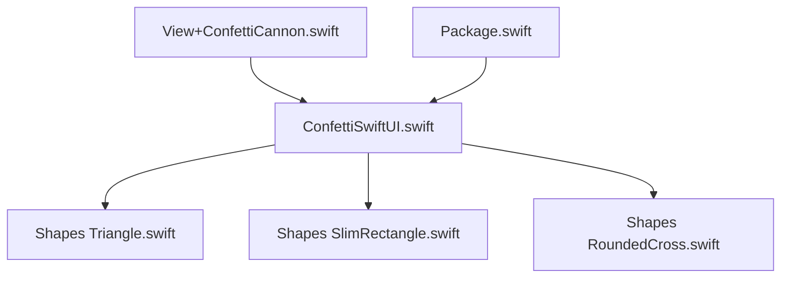

# simibac/ConfettiSwiftUI

> Bibliothèque SwiftUI qui ajoute des animations de confettis personnalisables dans une app iOS ou macOS.

## Le problème
Écrire à la main une animation de confettis dans SwiftUI prend du temps.

## Ce que ça fait vraiment
Un modificateur confettiCannon se déclenche quand une variable entière change. Formes par défaut, emojis, symboles SF ou texte, couleurs, angle, rayon, répétitions et retour haptique sont réglables. Tout est en SwiftUI pur. Une app de démonstration sert de configurateur.

## Comment c'est branché


## Essayer
```swift
import ConfettiSwiftUI
import SwiftUI

struct ContentView: View {
    @State private var trigger: Int = 0
    var body: some View {
        Button("🎉") { trigger += 1 }
            .confettiCannon(trigger: $trigger)
    }
}
```

## Coût et pièges
Gratuit. Il faut iOS 14 ou macOS 11 et Swift 5. Ajout via Swift Package Manager sur la branche master.

## Ce que ce n'est pas
Pas un moteur d'animation général : seulement des confettis.

## Alternatives
Aucune alternative nommée dans le README.

## Pour toi
À ignorer : cosmétique d'interface iOS, sans lien avec la data ou l'IA.

