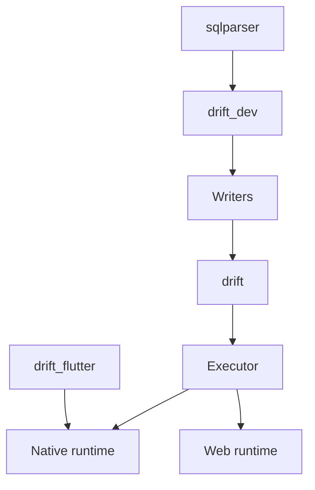

# simolus3/drift

> Reactive persistence library on top of SQLite, for Flutter and Dart developers.

## The problem
Writing SQL by hand in a Flutter application gives untyped code, with no automatic update stream for screens.

## What it actually does
Drift generates typed Dart code from tables and queries written in SQL or Dart. Every query becomes a stream that updates when the tables change. It handles transactions, migrations and joins, and runs on Android, iOS, desktop and web.

## How it is wired


## Trying it
```bash
dart pub global activate melos
dart pub get
melos bootstrap
```

## Cost and gotchas
Free, MIT. The commands above are for contributing to the repository; normal usage goes through the project's documentation.

## What it is not
Not a data or MLOps tool: it is local mobile persistence. Not a server ORM: it targets SQLite. The PostgreSQL and MariaDB extras are experiments.

## Alternatives
No alternative named in the README, apart from Hive and shared preferences cited for the speed comparison.

## For you
Ignore: outside your data / AI / MLOps profile, unless you write a Flutter application, in which case the library is mature.
