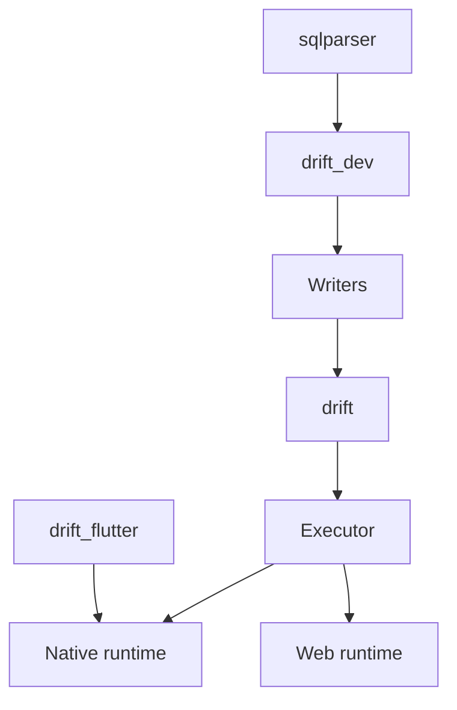

# simolus3/drift

> Bibliothèque de persistance réactive au-dessus de SQLite, pour les développeurs Flutter et Dart.

## Le problème
Écrire du SQL à la main dans une application Flutter donne du code non typé, sans flux de mise à jour automatique des écrans.

## Ce que ça fait vraiment
Drift génère du code Dart typé à partir de tables et de requêtes écrites en SQL ou en Dart. Toute requête devient un flux qui se met à jour quand les tables changent. Il gère transactions, migrations et jointures, et tourne sur Android, iOS, desktop et web.

## Comment c'est branché


## Essayer
```bash
dart pub global activate melos
dart pub get
melos bootstrap
```

## Coût et pièges
Gratuit, MIT. Les commandes ci-dessus servent à contribuer au dépôt ; l'usage normal passe par la documentation du projet.

## Ce que ce n'est pas
Pas un outil data ni MLOps : c'est de la persistance locale mobile. Pas un ORM serveur : il vise SQLite. Les extras PostgreSQL et MariaDB sont des expériences.

## Alternatives
Aucune alternative nommée dans le README, hors Hive et shared preferences cités pour la comparaison de vitesse.

## Pour toi
À ignorer : hors de ton profil data / IA / MLOps, sauf si tu écris une application Flutter, auquel cas la bibliothèque est mature.

