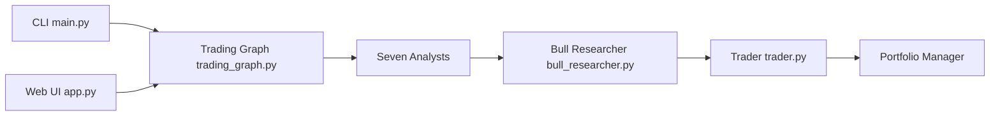

# simonlin1212/TradingAgents-astock

> Fork of the TradingAgents multi-agent framework adapted to the Chinese stock market (A-share), for research and teaching.

## The problem
TradingAgents targets US markets: its data, analysts and trading rules (T+0, no price-limit) do not suit Chinese stocks.

## What it actually does
Seven analysts (market, sentiment, news, fundamentals + policy, "hot money" flows, lock-up expiries) feed a bull/bear debate, a research manager, a trader under A-share constraints (T+1, limits, lots), a three-way risk debate and then a portfolio manager. Free data (mootdx, Tencent, Eastmoney, Sina…). CLI, Streamlit interface, performance statistics on decisions.

## How it is wired


## Trying it
```bash
git clone https://github.com/simonlin1212/tradingagents-astock.git
cd tradingagents-astock
pip install -e .
tradingagents
tradingagents-web
```

## Cost and gotchas
Each analysis makes 30 to 50 LLM calls billed to your key (MiniMax, DeepSeek, OpenAI, Anthropic…). Eastmoney rate-limits: the code includes throttling. Optional mode via a Claude Pro/Max subscription, reserved for personal use.

## What it is not
Not investment advice nor a trading system: no target price or stop in the code. The performance tool is not a backtest; below 20 samples the ratios are noise.

## Alternatives
- TauricResearch/TradingAgents: the upstream project, oriented to US markets.

## For you
Worth watching: useful as a study of multi-agent orchestration with debates; do not use it as a decision signal.
