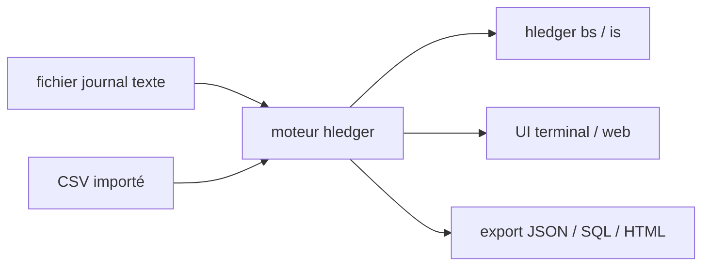

# simonmichael/hledger

> Plain-text double-entry accounting software, on the command line, for individuals and technical users.

## The problem
Accounting software locks your data in an opaque format, with no versioning or scripting.

## What it actually does
- Keeps the books in a versionable plain-text journal file, multi-currency, precise to 255 decimals.
- Produces reports (balance sheet, income statement) in text, HTML, JSON or SQL.
- Imports and exports CSV; partly compatible with Ledger, convertible with Beancount.
- Interfaces: CLI, terminal, web; scriptable through CLI, HTTP or API. Haskell code.

## How it is wired


## Trying it
```bash
hledger bs
hledger is --monthly
```

## Cost and gotchas
Free. The interfaces are described as basic; single main maintainer (Simon Michael, 140+ contributors). 2.x branch in progress (main), 1.x on hledger1.

## What it is not
Not a turnkey graphical accounting package nor an AI tool: the 1.x base is deliberately not AI-assisted. The installation commands are not in the provided README.

## Alternatives
Ledger CLI and Beancount: cited as compatible or convertible.

## For you
Keep an eye on it: nice for running your finances in versioned text, but outside the data/AI scope; GPL-3.0 has no impact for use as a tool.
