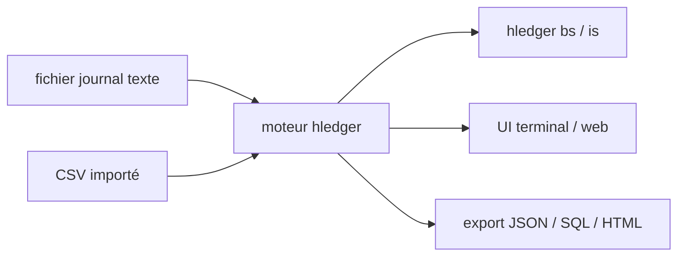

# simonmichael/hledger

> Logiciel de comptabilité en partie double en texte brut, en ligne de commande, pour particuliers et techniciens.

## Le problème
Les logiciels de compta ferment tes données dans un format opaque, sans versionnage ni scriptage.

## Ce que ça fait vraiment
- Tient la compta dans un fichier journal texte versionnable, multi-devises, précis à 255 décimales.
- Produit des rapports (bilan, compte de résultat) en texte, HTML, JSON ou SQL.
- Importe et exporte du CSV ; compatible en partie avec Ledger, convertible avec Beancount.
- Interfaces : CLI, terminal, web ; scriptable par CLI, HTTP ou API. Code Haskell.

## Comment c'est branché


## Essayer
```bash
hledger bs
hledger is --monthly
```

## Coût et pièges
Gratuit. Les interfaces sont décrites comme basiques ; mainteneur principal unique (Simon Michael, 140+ contributeurs). Branche 2.x en cours (main), 1.x sur hledger1.

## Ce que ce n'est pas
Pas un logiciel de compta graphique clés en main ni un outil d'IA : la base 1.x est volontairement non assistée par IA. Les commandes d'installation ne sont pas dans le README fourni.

## Alternatives
Ledger CLI et Beancount : cités comme compatibles ou convertibles.

## Pour toi
Surveiller : sympathique pour piloter ses finances en texte versionné, mais hors périmètre data/IA ; GPL-3.0 sans impact pour un usage en outil.

