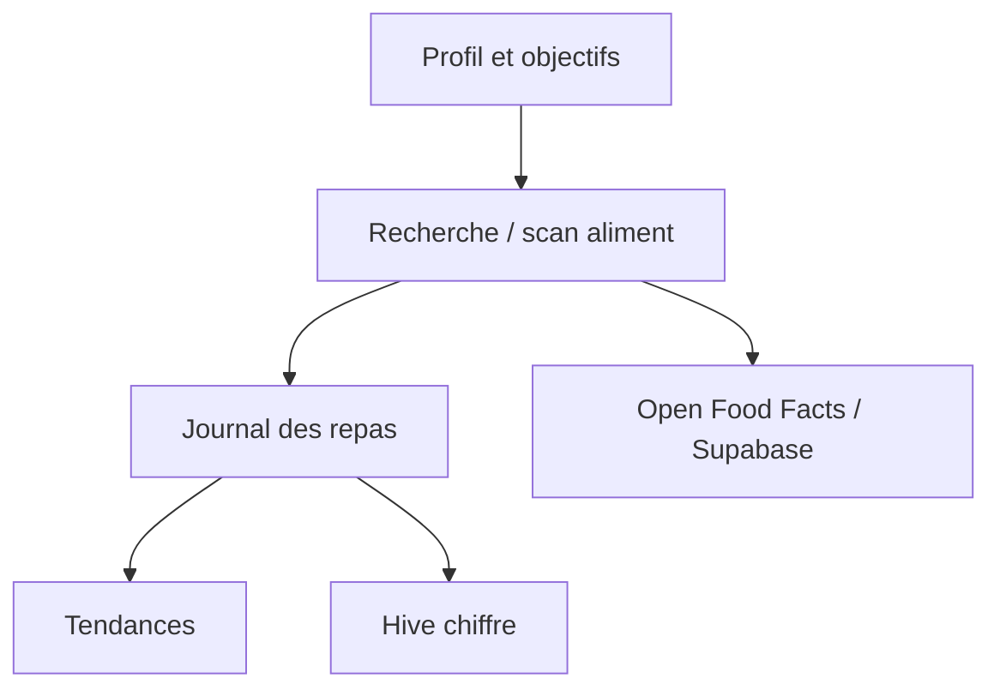

# simonoppowa/OpenNutriTracker

> Free mobile app for tracking calories, macros and micronutrients, which keeps the log on the phone.

## The problem
Common nutrition trackers impose an account, ads and a subscription for micronutrients.

## What it actually does
Food diary (search, barcode, quick add), targets computed from cited references (IOM 2005, WHO), trends, micronutrients, recipes, activities, water, fasting, JSON and CSV import/export. Data in AES-256 encrypted Hive (key in Keystore/Keychain). Sources: Open Food Facts, USDA, German BLS via a Supabase backend. Optional AI help (Anthropic, OpenAI, OpenRouter or personal server) with your own key; optional Sentry.

## How it is wired


## Trying it
```bash
apksigner verify --print-certs /path/to/opennutritracker.apk
```

## Cost and gotchas
Free, no ads. The AI help is labeled experimental, and the provider cost is on you. Food searches send the typed text to third-party services.

## What it is not
Not a medical application: the data is not validated, use with caution.

## Alternatives
No alternative named in the README (MyFitnessPal cited as a reference).

## For you
Ignore for your field; the only curiosity is its very detailed privacy documentation.
