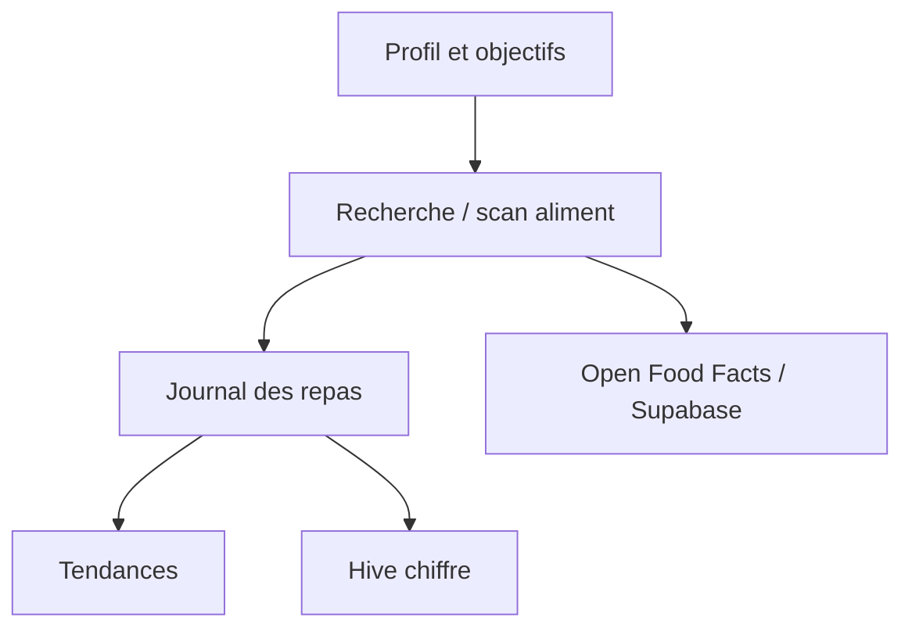

# simonoppowa/OpenNutriTracker

> Application mobile libre de suivi de calories, macros et micronutriments, qui garde le journal sur le téléphone.

## Le problème
Les suivis nutritionnels courants imposent compte, publicité et abonnement pour les micronutriments.

## Ce que ça fait vraiment
Journal alimentaire (recherche, code-barres, ajout rapide), cibles calculées selon des références citées (IOM 2005, OMS), tendances, micronutriments, recettes, activités, eau, jeûne, import/export JSON et CSV. Données dans Hive chiffré AES-256 (clé dans Keystore/Keychain). Sources : Open Food Facts, USDA, BLS allemand via un backend Supabase. Aide IA optionnelle (Anthropic, OpenAI, OpenRouter ou serveur personnel) avec ta propre clé ; Sentry optionnel.

## Comment c'est branché


## Essayer
```bash
apksigner verify --print-certs /path/to/opennutritracker.apk
```

## Coût et pièges
Gratuit, sans publicité. L'aide IA est étiquetée expérimentale, et le coût du fournisseur est à ta charge. Les recherches d'aliments envoient le texte saisi à des services tiers.

## Ce que ce n'est pas
Pas une application médicale : les données ne sont pas validées, à utiliser avec prudence.

## Alternatives
Aucune alternative nommée dans le README (MyFitnessPal cité comme référence).

## Pour toi
À ignorer pour le métier ; seule curiosité : sa documentation de confidentialité très détaillée.

