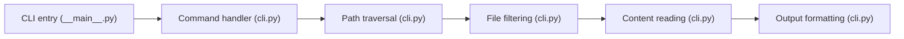

# simonw/files-to-prompt

> Small command-line utility that concatenates files into a single prompt for an LLM.

## The problem
Giving an LLM the contents of a whole folder means copy-pasting file by file, with their paths.

## What it actually does
Walks files and folders (arguments or stdin), filters by extension, `--ignore` patterns, hidden files and `.gitignore`, reads each file and writes it preceded by its path. Three formats: text with `---` separators, Claude XML (`--cxml`) or Markdown blocks (`--markdown`); optional line numbers, output to a file with `-o`.

## How it is wired


## Trying it
```bash
pip install files-to-prompt
files-to-prompt path/to/directory -e py --cxml
find . -name "*.py" -print0 | files-to-prompt --null
files-to-prompt path/to/directory -o output.txt
```

## Cost and gotchas
Free, no network call described. Watch the size of the output: it may exceed your model's context window.

## What it is not
Not a RAG tool nor smart selection: it concatenates, that's all. Last push in February 2025, 31 open issues.

## Alternatives
No alternative named in the README.

## For you
Adopt: a tiny, reliable tool to prepare a code context; its stability makes up for the lack of recent activity.
