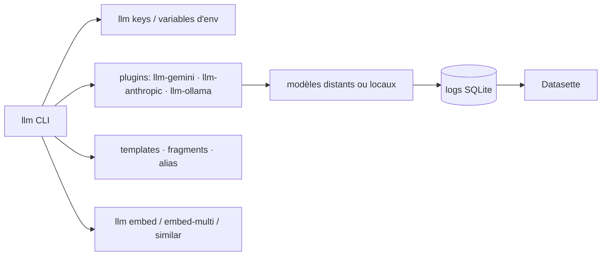

# simonw/llm

> Command-line tool and Python library for querying dozens of models.

## The problem
Each provider has its own SDK and format; comparing two models on the same prompt means writing
two scripts, and nothing keeps a record of what was asked.

## What it actually does
`llm` runs prompts from the command line against OpenAI, Claude, Gemini, Qwen, Gemma,
Kimi, DeepSeek, Mistral and dozens of others, through remote APIs or locally. It stores prompts
and responses in SQLite, generates and stores embeddings, extracts structured content from text
and images (schemas), and gives models the ability to run tools. Providers
are added through plugins (`llm install llm-gemini`, `llm-anthropic`, `llm-ollama`); keys are
managed with `llm keys set`. Templates, fragments and aliases make invocations reusable,
and a message store structures threads, turns, messages and parts.

## How it is wired


## Trying it
```bash
pip install llm
llm keys set openai
llm "Ten fun names for a pet pelican"
cat myfile.py | llm -s "Explain this code"
llm install llm-anthropic
llm -m claude-sonnet-5 'Impress me with wild facts about turnips'
llm chat -m gpt-4.1
uvx llm openai endpoint http://localhost:1234/v1 -m google/gemma-4-12b "What is the capital of France?"
```

## Cost and gotchas
The tool is free, API calls are not: each provider bills its tokens and requires its key.
The README flags a warning note about the Homebrew installation and PyTorch. Local models
go through a plugin (Ollama) and use your own machine.

## What it is not
It is not an agent framework or an orchestrator: it is a CLI and a library, with
tools and schemas as extras. Nor is it a model provider — everything goes through
plugins to existing services or runtimes.

## Alternatives
The README mentions neighboring tools by the same author: `strip-tags`, `ttok` and `Symbex`, which
combine with `llm` on the command line rather than replace it.

## For you
The tool to install first: logging all your prompts in SQLite and being able to replay them on
another model by changing a flag is what most workflows lack.
