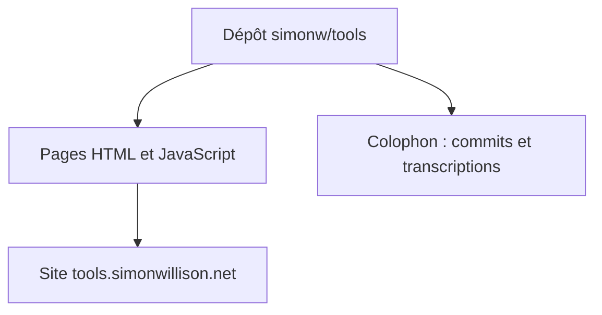

# simonw/tools

> A collection of HTML and JavaScript tools written with LLMs, published at tools.simonwillison.net.

## The problem
Not documented: the README is under 800 characters and does not describe a specific problem.

## What it actually does
Small web tools (HTML plus JavaScript) built mostly with the help of LLMs, presented as a low-stakes experiment in prompt-driven development. A "colophon" page lists the commit messages and transcripts of each tool. A Python collection also exists.

## How it is wired
Simplified diagram based on the sheet, no diagram provided.

## Trying it
No documented command: open the site tools.simonwillison.net in a browser.

## Cost and gotchas
Free, nothing to install. The list of tools is not in the README: you have to browse the site.

## What it is not
Not an application or a library: a heterogeneous collection of throwaway tools. The README says nothing about their quality or maintenance.

## Alternatives
No alternative named in the README.

## For you
Worth watching: interesting for seeing how a practitioner guides LLMs and keeps their transcripts, not for looking for a specific tool.
