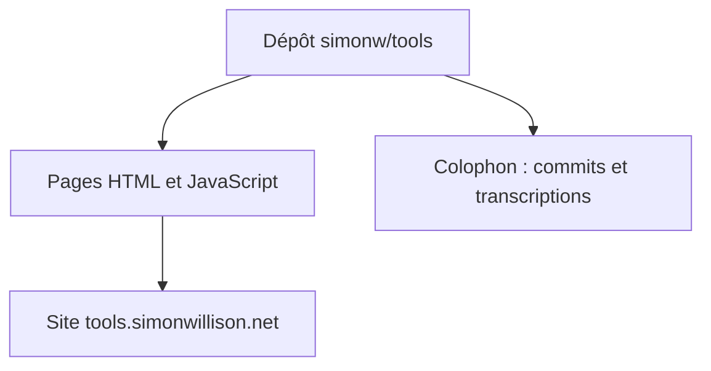

# simonw/tools

> Collection d'outils HTML et JavaScript écrits avec des LLM, publiée sur tools.simonwillison.net.

## Le problème
Non documenté : le README fait moins de 800 caractères et ne décrit pas de problème précis.

## Ce que ça fait vraiment
Des petits outils web (HTML plus JavaScript) bâtis surtout avec l'aide de LLM, présentés comme une expérience de développement guidé par prompts à faible enjeu. Une page « colophon » liste les messages de commit et les transcriptions de chaque outil. Une collection Python existe aussi.

## Comment c'est branché
Schéma simplifié d'après la fiche, sans diagramme fourni.

## Essayer
Aucune commande documentée : ouvrir le site tools.simonwillison.net dans un navigateur.

## Coût et pièges
Gratuit, rien à installer. La liste des outils n'est pas dans le README : il faut parcourir le site.

## Ce que ce n'est pas
Pas une application ni une bibliothèque : une collection hétérogène d'outils jetables. Le README ne dit rien de leur qualité ou de leur maintenance.

## Alternatives
Aucune alternative nommée dans le README.

## Pour toi
À surveiller : intéressant pour voir comment un praticien guide des LLM et garde ses transcriptions, pas pour y chercher un outil précis.

