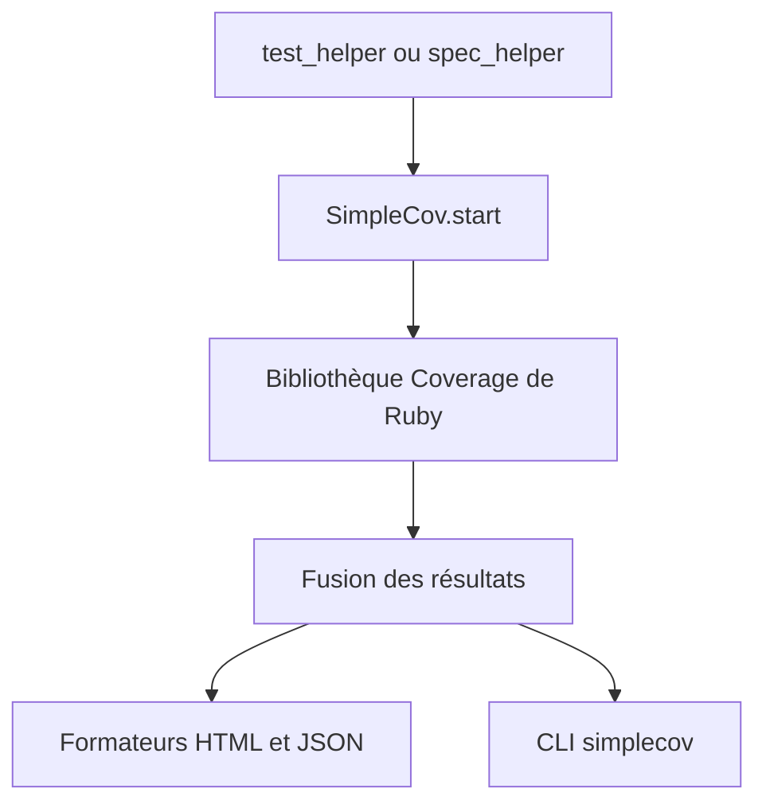

# simplecov-ruby/simplecov

> Code coverage tool for Ruby, with HTML and JSON reports and a tracking CLI.

## The problem
Knowing which lines of code the tests actually execute is hard without an aggregated report across the whole suite.

## What it actually does
SimpleCov relies on Ruby's `Coverage` library, merges the results of all tests and produces an HTML or JSON report. It adds per-file thresholds, coverage of only the modified lines (`simplecov patch`), tracking of which tests cover each line, view coverage and dead-code detection in production. The `ratchet` and `history` commands track progress.

## How it is wired
Simplified diagram based on the sheet, no diagram provided.



## Trying it
```bash
simplecov open
simplecov patch --base main --minimum 100
simplecov watch bundle exec rspec
simplecov uncovered --missing
```
```ruby
gem 'simplecov', require: false, group: :test
```

## Cost and gotchas
Free (MIT). `SimpleCov.start` must run before any application code. Test tracking (`track_tests`) has a performance cost, hence its optional activation.

## What it is not
Not a test quality tool: it measures execution, not the relevance of assertions. Covers Ruby only.

## Alternatives
No alternative cited in the README.

## For you
Ignore unless you have Ruby projects: coverage in Python is measured with other tools.
