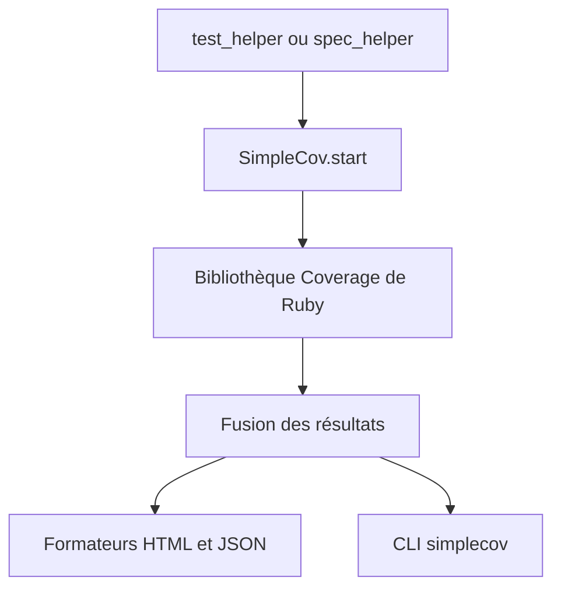

# simplecov-ruby/simplecov

> Outil de couverture de code pour Ruby, avec rapports HTML et JSON et une CLI de suivi.

## Le problème
Savoir quelles lignes de code les tests exécutent réellement est difficile sans rapport agrégé sur toute la suite.

## Ce que ça fait vraiment
SimpleCov s'appuie sur la bibliothèque `Coverage` de Ruby, fusionne les résultats de tous les tests et produit un rapport HTML ou JSON. Il ajoute des seuils par fichier, la couverture des seules lignes modifiées (`simplecov patch`), le suivi des tests couvrant chaque ligne, la couverture des vues et la détection de code mort en production. Les commandes `ratchet` et `history` suivent la progression.

## Comment c'est branché
Schéma simplifié d'après la fiche, sans diagramme fourni.



## Essayer
```bash
simplecov open
simplecov patch --base main --minimum 100
simplecov watch bundle exec rspec
simplecov uncovered --missing
```
```ruby
gem 'simplecov', require: false, group: :test
```

## Coût et pièges
Gratuit (MIT). `SimpleCov.start` doit s'exécuter avant tout code de l'application. Le suivi des tests (`track_tests`) a un coût en performances, d'où son activation optionnelle.

## Ce que ce n'est pas
Pas un outil de qualité des tests : il mesure l'exécution, pas la pertinence des assertions. Ne couvre que Ruby.

## Alternatives
Aucune alternative citée dans le README.

## Pour toi
À ignorer sauf si tu as des projets Ruby : la couverture en Python se mesure avec d'autres outils.

