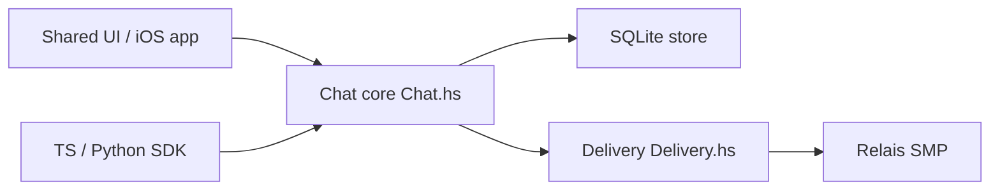

# simplex-chat/simplex-chat

> Messaging with no user identifiers, end-to-end encrypted, for those who want to protect their metadata.

## The problem
Encrypted messengers still expose who talks to whom (phone number, identifier, contact graph).

## What it actually does
Client-server network of disposable relays: messages are routed through unidirectional queues, with no account or global identifier; servers keep no user records and do not need to be persistent. Double ratchet, quantum-resistant key exchange, private routing, local encryption, Tor. Clients for iOS (SwiftUI), Android/desktop (Kotlin Multiplatform), CLI; core in Haskell; TypeScript, Node and Python SDKs for bots.

## How it is wired


## Trying it
```sh
curl -o- https://raw.githubusercontent.com/simplex-chat/simplex-chat/stable/install.sh | bash
simplex-chat
```

## Cost and gotchas
Free. Young platform (mobile apps since March 2022), default servers have no SLA. No IP protection without Tor. 1,298 open issues. AGPL-3.0.

## What it is not
Not a data work tool. Federation and P2P are not this model (README); security rests on the client and its documented limits.

## Alternatives
Signal, Matrix, Session, Cwtch, Ricochet (compared in the FAQ: they keep an identifier or a graph).

## For you
Interesting for privacy, with no direct data/AI use; ignore for the watch, except for bot automation.
