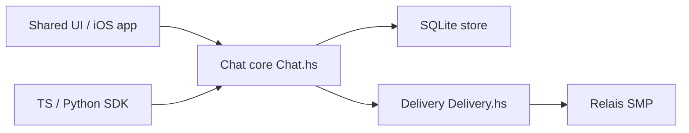

# simplex-chat/simplex-chat

> Messagerie sans identifiant utilisateur, chiffrée de bout en bout, pour qui veut protéger ses métadonnées.

## Le problème
Les messageries chiffrées exposent encore qui parle à qui (numéro, identifiant, graphe de contacts).

## Ce que ça fait vraiment
Réseau client-serveur de relais jetables : messages acheminés par files unidirectionnelles, sans compte ni identifiant global ; les serveurs ne gardent pas de dossier utilisateur et n'ont pas besoin d'être persistants. Double ratchet, échange de clés résistant au quantique, routage privé, chiffrement local, Tor. Clients iOS (SwiftUI), Android/desktop (Kotlin Multiplatform), CLI ; cœur en Haskell ; SDK TypeScript, Node, Python pour bots.

## Comment c'est branché


## Essayer
```sh
curl -o- https://raw.githubusercontent.com/simplex-chat/simplex-chat/stable/install.sh | bash
simplex-chat
```

## Coût et pièges
Gratuit. Plateforme jeune (apps mobiles depuis mars 2022), serveurs par défaut sans SLA. Pas de protection IP sans Tor. 1 298 issues ouvertes. AGPL-3.0.

## Ce que ce n'est pas
Pas un outil de travail data. Fédération et P2P ne sont pas ce modèle (README) ; la sécurité repose sur le client et ses limites documentées.

## Alternatives
Signal, Matrix, Session, Cwtch, Ricochet (comparés dans la FAQ : ils gardent un identifiant ou un graphe).

## Pour toi
Intéressant en vie privée, sans usage data/IA direct ; à ignorer pour la veille, sauf automatisation par bot.

