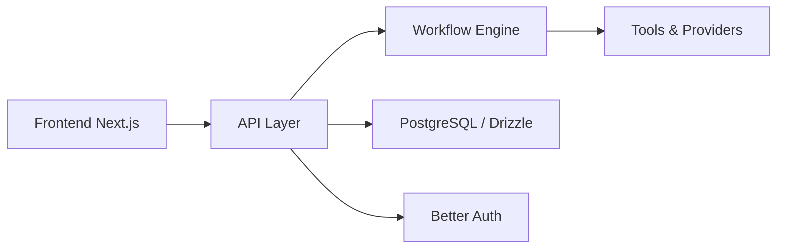

# simstudioai/sim

> Platform for building and deploying AI agents as visual workflows, with 270+ integrations.

## The problem
Connecting LLMs to Slack, Notion, databases or CRMs takes a lot of glue code and execution tracking.

## What it actually does
Sim offers a visual workflow editor (ReactFlow) backed by a Next.js API, a workflow executor, blocks/tools/model providers, knowledge bases and tables. It runs in the cloud (sim.ai), self-hosted via `npx sim-setup` (Docker Compose, PostgreSQL), or as a macOS application. It also exposes an MCP server.

## How it is wired


## Trying it
```bash
npx sim-setup
npx sim-setup status
npx sim-setup logs
npx sim-setup doctor
claude mcp add --transport http sim https://mcp.sim.ai/mcp
```

## Cost and gotchas
Node 20+ and Docker required; LLM keys at your expense. The Chat service is managed by Sim: the wizard connects a Chat API key through your browser, so a sim.ai account.

## What it is not
Not 100% autonomous when self-hosted: the Chat feature depends on a service managed by the vendor.

## Alternatives
No alternative named in the README.

## For you
Worth watching: handy for prototyping agents with many integrations, but the partial dependence on the Chat service and the large stack (Next, Postgres, E2B, Trigger.dev) weigh on serious MLOps use.
