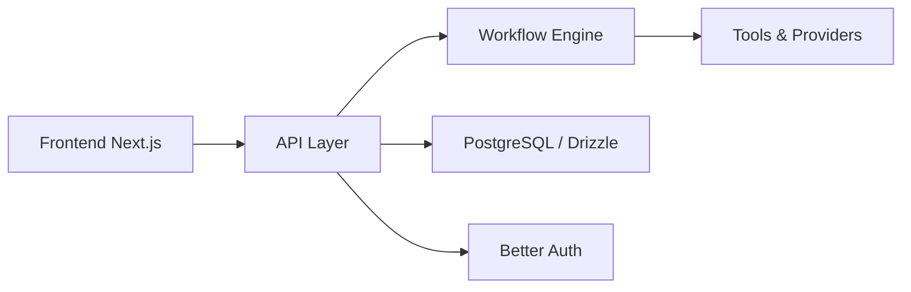

# simstudioai/sim

> Plateforme pour construire et déployer des agents IA en workflows visuels, avec 270+ intégrations.

## Le problème
Relier des LLM à Slack, Notion, des bases ou des CRM demande beaucoup de code de colle et de suivi d'exécution.

## Ce que ça fait vraiment
Sim propose un éditeur visuel de workflows (ReactFlow) adossé à une API Next.js, un exécuteur de workflows, des blocs/outils/fournisseurs de modèles, des bases de connaissances et des tables. Il tourne en cloud (sim.ai), en auto-hébergé via `npx sim-setup` (Docker Compose, PostgreSQL), ou en application macOS. Il expose aussi un serveur MCP.

## Comment c'est branché


## Essayer
```bash
npx sim-setup
npx sim-setup status
npx sim-setup logs
npx sim-setup doctor
claude mcp add --transport http sim https://mcp.sim.ai/mcp
```

## Coût et pièges
Node 20+ et Docker requis ; clés LLM à ta charge. Le service Chat est géré par Sim : le wizard connecte une clé d'API Chat via ton navigateur, donc un compte sim.ai.

## Ce que ce n'est pas
Ce n'est pas 100 % autonome en auto-hébergé : la fonction Chat dépend d'un service géré par l'éditeur.

## Alternatives
Aucune alternative nommée dans le README.

## Pour toi
À surveiller : pratique pour prototyper des agents à intégrations multiples, mais la dépendance partielle au service Chat et le gros empilement (Next, Postgres, E2B, Trigger.dev) pèsent pour un usage MLOps sérieux.

